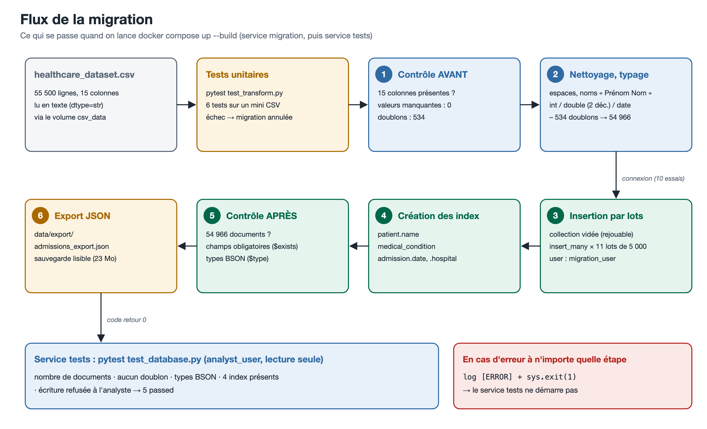
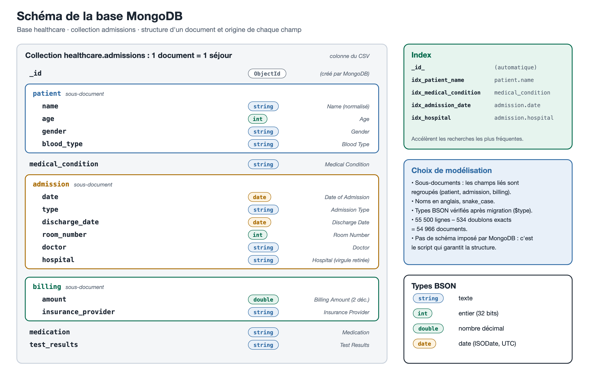
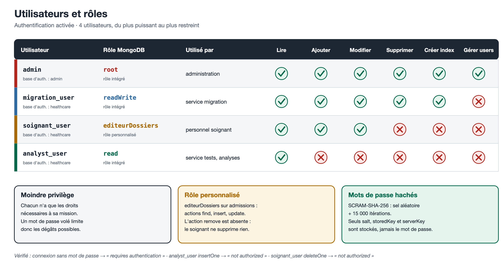
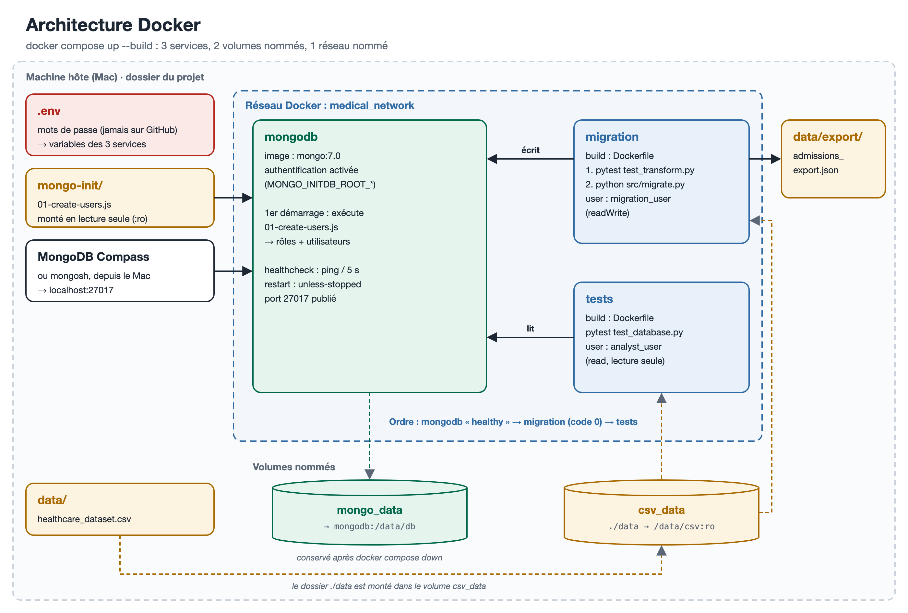

# Migration de données médicales vers MongoDB

Projet 5 du parcours **Data Engineer** (OpenClassrooms) : migrer un fichier CSV de 55 500 séjours hospitaliers vers une base **MongoDB**, le tout conteneurisé avec **Docker**.

---

## Sommaire

1. [Fonctionnement et utilité](#1-fonctionnement-et-utilité)
2. [Structure du dépôt](#2-structure-du-dépôt)
3. [Prérequis](#3-prérequis)
4. [Déploiement, ligne par ligne](#4-déploiement-ligne-par-ligne)
5. [Ce qui se passe pendant la migration](#5-ce-qui-se-passe-pendant-la-migration)
6. [Schéma de la base](#6-schéma-de-la-base)
7. [Authentification et rôles](#7-authentification-et-rôles)
8. [Architecture Docker](#8-architecture-docker)
9. [Tests](#9-tests)
10. [Opérations CRUD](#10-opérations-crud)
11. [Lancer le projet sans Docker (développement)](#11-lancer-le-projet-sans-docker-développement)
12. [Dépannage](#12-dépannage)

---

## 1. Fonctionnement et utilité

**Le besoin.** Un client dispose de données médicales de patients dans un fichier CSV et rencontre des problèmes de *scalabilité* : un fichier plat ne permet ni recherches rapides, ni accès concurrents, ni gestion des droits. On migre donc ces données vers MongoDB, une base NoSQL orientée documents qui se met à l'échelle horizontalement.

**Ce que fait le projet**, avec une seule commande (`docker compose up --build`) :

1. démarre une base MongoDB **avec authentification** et crée automatiquement des utilisateurs aux droits différents ;
2. **contrôle** le CSV (colonnes, types, valeurs manquantes, doublons) ;
3. **nettoie et type** les données (dates, entiers, décimaux, noms normalisés, doublons supprimés) ;
4. **insère** les 54 966 séjours uniques dans MongoDB, par lots ;
5. crée les **index** utiles aux recherches ;
6. **vérifie** la base après migration (nombre de documents, champs, types) et **exporte** une sauvegarde JSON ;
7. lance des **tests automatisés** sur la base, avec un utilisateur en lecture seule.

Le script est **rejouable** : le relancer ne crée pas de doublons. Il est **portable** : il tourne à l'identique sur n'importe quelle machine équipée de Docker.

**Les données** : [Healthcare Dataset (Kaggle)](https://www.kaggle.com/datasets/prasad22/healthcare-dataset), 55 500 lignes, 15 colonnes, données fictives.

---

## 2. Structure du dépôt

```
migration-donnees-medicales-mongodb/
├── data/                         # le CSV (non versionné) et l'export JSON
│   └── .gitkeep
├── docs/                         # schémas (PNG), leurs sources, recherches AWS
├── mongo-init/
│   └── 01-create-users.js        # rôles et utilisateurs, exécuté au 1er démarrage de MongoDB
├── notebooks/
│   └── 01_exploration_csv.ipynb  # exploration du CSV avant migration
├── src/
│   ├── config.py                 # réglages lus depuis les variables d'environnement
│   ├── transform.py              # lecture, contrôle, nettoyage, transformation en documents
│   ├── migrate.py                # script principal de migration
│   └── crud.py                   # démonstration des opérations CRUD
├── tests/
│   ├── conftest.py
│   ├── test_transform.py         # 6 tests unitaires (sans MongoDB)
│   └── test_database.py          # 5 tests d'intégration (après migration)
├── .env.example                  # modèle des variables d'environnement
├── .dockerignore
├── .gitignore
├── Dockerfile                    # image de la migration
├── docker-compose.yml            # 3 services, 2 volumes, 1 réseau
├── requirements.txt              # dépendances (versions figées)
└── requirements-dev.txt          # + outils du notebook
```

---

## 3. Prérequis

| Outil | Version utilisée | Rôle |
|---|---|---|
| Docker Desktop (Docker + Compose) | Docker 29, Compose v5 | lancer MongoDB et la migration |
| Git | 2.x | récupérer le projet |
| Le fichier `healthcare_dataset.csv` | – | à télécharger sur Kaggle |
| Python (optionnel) | 3.12 | uniquement pour lancer le projet hors Docker |

Les bibliothèques Python (versions figées dans `requirements.txt`) : `pandas 2.2.3`, `pymongo 4.10.1`, `pytest 8.3.4`. Dans Docker, elles sont installées automatiquement dans une image `python:3.12-slim`. MongoDB tourne en version **7.0** (image officielle `mongo:7.0`).

---

## 4. Déploiement, ligne par ligne

### 4.1 Récupérer le projet

```bash
git clone https://github.com/monsi5991/migration-donnees-medicales-mongodb.git
cd migration-donnees-medicales-mongodb
```

### 4.2 Fournir les données

Copier `healthcare_dataset.csv` dans le dossier `data/`. Il n'est pas versionné : ce sont des données de santé.

### 4.3 Créer le fichier des mots de passe

```bash
cp .env.example .env          # Windows : copy .env.example .env
```

Puis ouvrir `.env` et **remplacer les 4 mots de passe**. Utiliser uniquement des lettres et des chiffres, car les caractères `@ : /` casseraient l'URI de connexion. Le fichier `.env` est ignoré par Git : il n'est jamais publié.

| Variable | Rôle |
|---|---|
| `MONGO_DB` | nom de la base (`healthcare`) |
| `MONGO_ROOT_USER` / `MONGO_ROOT_PASSWORD` | administrateur MongoDB (active l'authentification) |
| `MONGO_MIGRATION_USER` / `_PASSWORD` | utilisateur du script de migration (`readWrite`) |
| `MONGO_ANALYST_USER` / `_PASSWORD` | utilisateur en lecture seule (`read`) |
| `MONGO_SOIGNANT_USER` / `_PASSWORD` | personnel soignant (rôle personnalisé, sans suppression) |

### 4.4 Vérifier la configuration (facultatif)

```bash
docker compose config
```

Docker Compose affiche le fichier avec les valeurs du `.env` à la place des `${...}`. S'il y a une erreur (indentation, variable manquante), elle apparaît ici.

### 4.5 Lancer

```bash
docker compose up --build
```

| Partie de la commande | Signification |
|---|---|
| `docker compose` | lit `docker-compose.yml` et `.env` |
| `up` | crée le réseau et les volumes, puis démarre les 3 services |
| `--build` | (re)construit l'image de migration à partir du `Dockerfile` |

On voit successivement :

```
mongodb    | Utilisateurs et rôles créés sur la base healthcare
migration  | 6 passed
migration  | [INFO] 1. Lecture du CSV ...
migration  | [INFO] Migration terminée avec succès
migration exited with code 0
tests      | 5 passed
tests exited with code 0
```

MongoDB reste démarré. `Ctrl + C` arrête tout.

### 4.6 Commandes utiles

| Commande | Effet |
|---|---|
| `docker compose up --build -d` | tout lancer en arrière-plan |
| `docker compose ps -a` | état : `mongodb` *Up (healthy)*, `migration` et `tests` *Exited (0)* |
| `docker compose logs migration` | relire les logs de la migration |
| `docker compose logs tests` | relire les logs des tests |
| `docker compose run --rm migration` | relancer seulement la migration |
| `docker compose down` | arrêter et supprimer les conteneurs (**les données restent** dans le volume) |
| `docker compose down -v` | idem **et** supprimer les volumes (base vide au prochain lancement) |

> Les utilisateurs MongoDB ne sont créés qu'au **premier** démarrage, quand le volume `mongo_data` est vide. Après avoir modifié un mot de passe dans `.env`, il faut donc repartir de zéro avec `docker compose down -v`.

### 4.7 Se connecter à la base

- **Compass** : `mongodb://admin:<MOT_DE_PASSE_ADMIN>@localhost:27017/`
- **mongosh** :
  ```bash
  docker exec -it mongodb mongosh -u admin -p <MOT_DE_PASSE_ADMIN>
  ```

---

## 5. Ce qui se passe pendant la migration



Le service `migration` exécute d'abord les **tests unitaires**. Il ne lance `src/migrate.py` que s'ils réussissent (`pytest ... && python src/migrate.py`).

| Étape | Fonction | Détail |
|---|---|---|
| 1. Lecture et contrôle **avant** | `read_csv`, `check_columns`, `integrity_report` | le CSV est lu **tout en texte** pour maîtriser les conversions ; on vérifie les 15 colonnes, et on compte les valeurs manquantes (0) et les doublons (534) |
| 2. Nettoyage et typage | `clean` | espaces supprimés ; noms au format « Prénom Nom » (`bOBBy JacKsOn` → `Bobby Jackson`) ; virgule finale retirée des hôpitaux ; `Age` et `Room Number` en entiers, `Billing Amount` en décimal arrondi à 2 chiffres, dates en `datetime` ; **534 doublons exacts supprimés** → 54 966 lignes |
| 3. Insertion | `connect`, `insert_documents` | connexion avec `migration_user` (10 essais, le temps que MongoDB démarre) ; la collection est **vidée** puis remplie par `insert_many`, en **lots de 5 000** (11 lots) |
| 4. Index | `create_indexes` | 4 index (voir partie 6) |
| 5. Contrôle **après** | `check_after_migration` | 54 966 documents ; aucun champ obligatoire absent (`$exists`) ; types BSON conformes (`$type` : `int`, `double`, `date`) |
| 6. Export | `export_collection` | sauvegarde JSON de la collection dans `data/export/admissions_export.json` (≈ 23 Mo) |

Chaque étape est journalisée (`logging`, avec horodatage). En cas d'erreur, le script affiche `Échec de la migration : <raison>` et se termine avec le **code 1**. Le service `tests` ne démarre alors pas (`condition: service_completed_successfully`).

**Constats sur les données d'origine** (détaillés dans [`notebooks/01_exploration_csv.ipynb`](notebooks/01_exploration_csv.ipynb)) :

| Constat | Traitement |
|---|---|
| 55 500 lignes, 15 colonnes | contrôle de présence des colonnes |
| aucune valeur manquante | contrôle maintenu dans le script |
| 534 doublons exacts | supprimés |
| noms en casse aléatoire | normalisés (`str.title()`) |
| dates lues comme du texte | converties en dates |
| 108 montants négatifs | conservés (avoirs probables), arrondis à 2 décimales |

---

## 6. Schéma de la base



**Base** `healthcare`, **collection** `admissions`. **Un document = un séjour hospitalier.** Les champs liés sont regroupés dans des **sous-documents** :

```json
{
  "_id": ObjectId("..."),
  "patient": { "name": "Bobby Jackson", "age": 30, "gender": "Male", "blood_type": "B-" },
  "medical_condition": "Cancer",
  "admission": {
    "date": ISODate("2024-01-31"),
    "type": "Urgent",
    "discharge_date": ISODate("2024-02-02"),
    "room_number": 328,
    "doctor": "Matthew Smith",
    "hospital": "Sons and Miller"
  },
  "billing": { "amount": 18856.28, "insurance_provider": "Blue Cross" },
  "medication": "Paracetamol",
  "test_results": "Normal"
}
```

| Champ | Type BSON | Colonne du CSV |
|---|---|---|
| `patient.name` | string | Name (normalisé) |
| `patient.age` | int | Age |
| `patient.gender` | string | Gender |
| `patient.blood_type` | string | Blood Type |
| `medical_condition` | string | Medical Condition |
| `admission.date` | date | Date of Admission |
| `admission.type` | string | Admission Type |
| `admission.discharge_date` | date | Discharge Date |
| `admission.room_number` | int | Room Number |
| `admission.doctor` | string | Doctor |
| `admission.hospital` | string | Hospital |
| `billing.amount` | double | Billing Amount |
| `billing.insurance_provider` | string | Insurance Provider |
| `medication` | string | Medication |
| `test_results` | string | Test Results |

**Index** (en plus de `_id_`, créé automatiquement) :

| Nom | Champ | Recherche visée |
|---|---|---|
| `idx_patient_name` | `patient.name` | retrouver les séjours d'un patient |
| `idx_medical_condition` | `medical_condition` | statistiques par pathologie |
| `idx_admission_date` | `admission.date` | recherches par période |
| `idx_hospital` | `admission.hospital` | activité par établissement |

---

## 7. Authentification et rôles



L'authentification est activée par les variables `MONGO_INITDB_ROOT_USERNAME` / `MONGO_INITDB_ROOT_PASSWORD`. Au premier démarrage, l'image MongoDB exécute [`mongo-init/01-create-users.js`](mongo-init/01-create-users.js), qui crée un rôle personnalisé et trois utilisateurs dans la base `healthcare`. Les mots de passe viennent du `.env` : aucun n'est écrit dans le code.

| Utilisateur | Rôle | Droits | Utilisé par |
|---|---|---|---|
| `admin` | `root` | tous | administration |
| `migration_user` | `readWrite` | lire, écrire, supprimer, créer des index sur `healthcare` | service `migration` |
| `soignant_user` | `editeurDossiers` (personnalisé) | `find`, `insert`, `update` sur `admissions`, **sans suppression** | personnel soignant |
| `analyst_user` | `read` | lecture seule | service `tests`, analyses |

C'est le **principe du moindre privilège** : chacun n'a que les droits nécessaires.

**Hachage des mots de passe.** MongoDB ne stocke pas les mots de passe. Avec **SCRAM-SHA-256**, il conserve un sel aléatoire et des clés dérivées (`storedKey`, `serverKey`) calculées sur **15 000 itérations**.

**Vérifications** (le mot de passe de chaque utilisateur se trouve dans `.env`) :

```bash
# Sans mot de passe → "requires authentication"
docker exec -it mongodb mongosh --eval "db.getSiblingDB('healthcare').admissions.countDocuments()"

# Analyste : lecture OK (54966), écriture → "not authorized"
docker exec -it mongodb mongosh -u analyst_user -p <MDP> --authenticationDatabase healthcare healthcare --eval "db.admissions.countDocuments()"
docker exec -it mongodb mongosh -u analyst_user -p <MDP> --authenticationDatabase healthcare healthcare --eval "db.admissions.insertOne({test: 1})"

# Soignant : suppression → "not authorized"
docker exec -it mongodb mongosh -u soignant_user -p <MDP> --authenticationDatabase healthcare healthcare --eval "db.admissions.deleteOne({})"

# Hachage : iterationCount 15000, salt, storedKey, serverKey (pas de mot de passe en clair)
docker exec -it mongodb mongosh -u admin -p <MDP_ADMIN> --eval "db.getSiblingDB('admin').system.users.findOne({user:'analyst_user'}).credentials"
```

---

## 8. Architecture Docker



| Élément | Nom | Rôle |
|---|---|---|
| Service | `mongodb` | base MongoDB 7.0 avec authentification ; `healthcheck` (ping toutes les 5 s) ; `restart: unless-stopped` ; port 27017 publié |
| Service | `migration` | image construite par le `Dockerfile` ; tests unitaires puis migration ; démarre quand `mongodb` est *healthy* |
| Service | `tests` | même image ; `pytest tests/test_database.py` ; démarre quand `migration` s'est terminé avec le code 0 |
| Volume nommé | `mongo_data` | données MongoDB (`/data/db`), conservées après `docker compose down` |
| Volume nommé | `csv_data` | le dossier `./data` de l'hôte, monté en **lecture seule** dans `/data/csv` |
| Montage | `./mongo-init` | script de création des utilisateurs (lecture seule) |
| Montage | `./data/export` | récupération de l'export JSON sur l'hôte |
| Réseau nommé | `medical_network` | les conteneurs se joignent par leur nom (`MONGO_HOST=mongodb`) |

**Le Dockerfile** part de `python:3.12-slim`. Il installe les dépendances **avant** de copier le code, pour profiter du cache des couches Docker. Il copie ensuite `src/` et `tests/`. Le `.dockerignore` exclut `.env`, `venv/`, `data/` et `.git` de l'image.

---

## 9. Tests

| Fichier | Type | Nombre | Lancé par |
|---|---|---|---|
| `tests/test_transform.py` | unitaires, sur un mini CSV de 3 lignes (dont 1 doublon), sans MongoDB | 6 | service `migration`, avant la migration |
| `tests/test_database.py` | intégration, sur la base migrée, en lecture seule | 5 | service `tests`, après la migration |

**Tests unitaires** : colonnes reconnues, erreur si une colonne manque, détection des doublons, nettoyage et types, normalisation des noms, forme exacte du document.

**Tests de la base** : nombre de documents égal au nombre de lignes uniques du CSV, aucun doublon en base, types BSON, présence des 4 index, **écriture refusée** à l'utilisateur analyste.

Lancer les tests unitaires en local :

```bash
pytest -v tests/test_transform.py
```

---

## 10. Opérations CRUD

[`src/crud.py`](src/crud.py) montre les quatre opérations avec pymongo sur la collection migrée :

| Opération | Méthode | Exemple |
|---|---|---|
| **C**reate | `insert_one` | ajout d'un séjour « Test Patient » |
| **R**ead | `find_one`, `count_documents`, `aggregate` | retrouver le patient, compter les séjours pour diabète (9 216), facture moyenne par pathologie (`$group` + `$avg`) |
| **U**pdate | `update_one` + `$set` | modification du résultat de test |
| **D**elete | `delete_many` | suppression du patient de test |

---

## 11. Lancer le projet sans Docker (développement)

```bash
python3.12 -m venv venv
source venv/bin/activate              # Windows : venv\Scripts\activate
pip install -r requirements-dev.txt

# MongoDB de test, sans authentification
docker run -d --name mongo-test -p 27017:27017 mongo:7.0

python src/migrate.py                 # migration
python src/crud.py                    # démonstration CRUD
docker rm -f mongo-test               # nettoyage
```

Sans variables d'environnement, `src/config.py` utilise `localhost:27017` sans authentification.

---

## 12. Dépannage

| Problème | Solution |
|---|---|
| `variable is not set` | le fichier `.env` manque : `cp .env.example .env` |
| `port is already allocated` | un autre MongoDB utilise le port 27017 : `docker ps`, puis l'arrêter |
| `Authentication failed` | `.env` modifié après le 1er lancement : `docker compose down -v` puis `docker compose up --build` |
| `migration exited with code 1` | `docker compose logs migration`, lire la ligne `Échec de la migration` |
| `FileNotFoundError ... healthcare_dataset.csv` | le CSV n'est pas dans `data/` |
| une modification du code n'est pas prise en compte | relancer avec `--build` |

---

## Pour aller plus loin : déploiement sur AWS

Les options d'hébergement de MongoDB sur AWS (Amazon DocumentDB, MongoDB Atlas, EC2, ECS), avec leurs coûts et une recommandation, sont étudiées dans [`docs/recherches_aws.md`](docs/recherches_aws.md).

---

*Simon Sagna – OpenClassrooms, parcours Data Engineer – novembre 2026*
